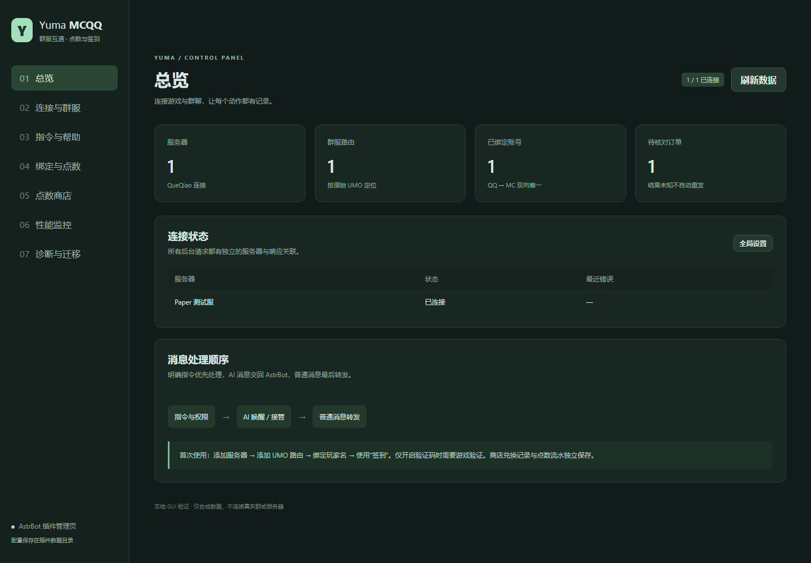

# Yuma MCQQ

独立的 AstrBot 插件，连接 **NapCat/OneBot ↔ Paper + QueQiao V2**。按新设计重写；旧插件只用于显式数据迁移。



## 已实现

- 默认直接绑定玩家名，可选游戏验证码验证真实 UUID；QQ/玩家名全局唯一，已验证 UUID 也唯一，修改/解绑保留冷却、余额和历史。
- **游戏签到 → 群签到**：先执行 `signin click 玩家`，再检查群签到，一日只发一次点数；最终分别显示玩家、群结果、游戏结果，覆盖四种成功/重复组合。
- 每日签到时段可选，时段外整条签到指令不执行游戏命令；支持按日期安排点数倍率或奖励范围活动，并在 GUI 预览生效规则。
- 一种群积分货币，显示名称可自定义；点数排行显示总余额前 10 名及当前 MC 玩家名。支持点数商店、私聊文本/唯一码/游戏命令商品、确认兑换、补领和未知交付核对。
- 每条自定义 RCON 指令独立参数、清洗前缀、解析规则及回复模板；共用颜色/控制码清洗器。
- 23 个内置指令和自定义指令均注册到 AstrBot **管理行为**，可改触发名、别名和启停；可使用 AstrBot 唤醒方式或设置本插件独立前缀。
- `mc帮助` 默认发送一张深色图片，按全局帮助顺序从上到下排布，每列最多 15 条命令，超出自动增加列，不分页；连续同类内容用矩形框住。也可切换文字，编辑说明、独立显隐与排序，采用当前管理行为名称及权限。
- 按原始 **UMO** 回复和路由；明确指令、AI 唤醒或已接管消息不转发。普通消息优先在群聊图片转述前发送到游戏；当前群可能触发主动回复时，保留末位判断。
- 文本、@、QQ 表情、图片、链接、合并消息、语音、视频、文件、引用；9 类标签颜色可在 GUI 修改，`{reply}` 放置引用，悬浮默认三行原作者/原内容/原时间，无需 ChatImage。
- QueQiao 正向/反向连接、独立服务器显示名称；游戏聊天、加入、退出、死亡、成就事件分别开关。
- `tps` / `mspt` / `ping` 返回实际 RCON 文字；`服务器状态` 只回复在线/离线；`性能图` 提供定时采样的历史 PNG，GUI 查看曲线。
- AstrBot 内嵌管理 GUI：连接/路由、指令与帮助、绑定/点数、商店/订单、监控、解析预览与迁移。数据列表分页，服务器 ID 可连同关联数据修改；引用标签、颜色和悬浮分别配置。

## 安装与首次配置

要求 Python 3.11+、AstrBot **4.29+ / <5**、NapCat/OneBot、Paper 和官方 [QueQiao](https://github.com/17TheWord/QueQiao)。1.3.0 已在真实 AstrBot 4.29.1 框架中进行隔离集成测试。动态命令桥接使用 AstrBot 内部注册接口，升级框架应重新跑集成测试。

在 AstrBot 插件管理中使用[本仓库](https://github.com/Junnstoy/astrbot_plugin_yuma_mcqq)安装或更新，确认所安装代码的版本为 1.4.2。手动安装时将插件目录命名为 `astrbot_plugin_yuma_mcqq`，在 AstrBot 使用的 Python 环境安装 `requirements.txt`，然后加载插件。本次补丁、签到策略与帮助样式见 [1.4 系列升级说明](docs/UPGRADE_1_4.md)，管理功能见 [1.3 升级说明](docs/UPGRADE_1_3.md)，绑定迁移见 [1.2 升级说明](docs/UPGRADE_1_2.md)，已有 1.0 数据的用户也请阅读 [1.1 身份升级说明](docs/UPGRADE_1_1.md)。

当前 1.4.2 通过 [feat/session-checkin 分支](https://github.com/Junnstoy/astrbot_plugin_yuma_mcqq/tree/feat/session-checkin)交付，对应 [PR #2](https://github.com/Junnstoy/astrbot_plugin_yuma_mcqq/pull/2)，尚未合并到 `main`。安装或更新时请选择该分支，并核对 `metadata.yaml` 的版本；只更新默认分支暂时不会取得本次补丁。

1. 在 Paper 安装 QueQiao 与 LiteSignIn，启用 QueQiao WebSocket 和其 RCON 支持；先在服务器确认 `signin click 玩家名` 可用。
2. 打开 AstrBot → 插件详情 → 插件视图 → `dashboard`。添加服务器，填写与 QueQiao 一致的鉴权名称 `name`；可另设 `display_name` 用于 QQ 展示。正向模式填写 QueQiao 的 WebSocket 地址；反向模式由 QueQiao 连接机器人监听地址，必须设置非空 token。
3. 在目标 QQ 群执行 AstrBot `/sid`，将得到的完整 UMO 添加为群服路由；配置点数奖励、管理员与转发方向。通过路由行“签到时段与活动”设置每日时段及日期活动；默认全天可签、没有活动。
4. 在 AstrBot 管理行为中设置所需指令名称。默认发送 `绑定 玩家名` 即可完成；只有打开“游戏验证码验证”后才需要在游戏发送 `bind 验证码`。全局设置可修改货币名称和本插件唤醒前缀。
5. 使用 `签到` 验证游戏、群签到顺序；默认完整回复为 `玩家: {player}`、`{group_result}`、`{game_result}` 三行。默认 LiteSignIn 回包无需编写规则；诊断页面可模拟四种结果，不执行游戏命令。
6. 在商店 GUI 添加商品并上架。游戏交付商品必须填写可确认成功的回包规则。通过转发类型与游戏事件复选框选择消息范围。
7. QQ 已提供的可公开访问图片、视频、语音和文件链接可直接点击，不要求开启缓存服务。本地媒体、需转存资源和完整合并消息页面才需要配置 `media.public_base` 等缓存服务选项。详见 [传输与部署](docs/TRANSPORT.md)。

1.4.2 调整普通群消息的转发时机，减少群聊自动图片理解带来的等待，详见 [图片转发顺序](docs/UPGRADE_1_4.md#图片转发顺序)。已有公网链接仍直接转发，缺少链接时保留有限并发查询；AstrBot 预处理中的图片下载仍可能在插件前发生。本版已移除临时慢阶段日志，不再需要搜索相关提示或调整日志过滤器。

`command_prefix` 留空时沿用当前会话的 AstrBot 唤醒方式，例如 `/签到` 或 @机器人 后发送；填写 `mc` 后，本插件命令使用 `mc签到` 或 `mc 签到` 这样的独立前缀。这里展示的是默认命令名，实际名称仍以管理行为为准。首次创建后配置由插件 GUI 管理并保存到插件数据目录，基础配置面板中的 `enabled` 仅用于首次初始化。

| 默认指令 | 用途 |
| --- | --- |
| `mc帮助` | 按配置返回单张多栏图片或完整文字，采用当前名称、说明、显示开关与排序 |
| `绑定 玩家名` / `我的绑定` / `修改绑定 玩家名` / `解绑` | 直接绑定，或按开关验证后绑定；查询及变更 |
| `签到` / `点数` | 两阶段签到和账户查询 |
| `点数排行` | 当前作用域总余额前 10 名，显示当前绑定 MC 玩家名；未绑定显示“未绑定玩家”，不显示 QQ 号 |
| `点数商店` / `兑换 商品ID` / `确认兑换 订单ID` | 浏览及购买一件商品 |
| `兑换记录` / `补领 订单ID` | 查看订单，重新私聊同一份已分配奖励 |
| `服务器状态` | 仅回复 QueQiao 连接在线或离线，不需要参数 |
| `tps` / `mspt` / `ping` | 执行服务器配置的查询，返回清洗后的实际 RCON 文本，不需要参数 |
| `性能图 [小时数]` | 历史 PNG，默认 24 小时，范围 1–168 |
| `添加点数` / `扣除点数` / `设置点数` | 管理员：QQ或绑定名、数量、可选原因 |
| `绑定 QQ号 MC名` / `修改绑定 QQ号 MC名` / `解绑 QQ号` | 管理员代操作，直接完成且不受 CD 限制；仍保持绑定唯一性 |
| `cmd 游戏命令` | 管理员向当前群对应服务器发送原样 RCON，例如 `cmd cmi ping rincho` |
| `订单核对 订单ID success或failed 依据` | 管理员核实交付后结算 |

帮助图片沿用现有图片开关与显示设置，不用重新填写说明。每列最多 15 条命令，分类标题不计数；按全局顺序从左栏到右栏延续，同类跨列或被其他分类打断后使用“续”标题。默认帮助命令排第一，已有显式排序仍优先。查看[单图帮助样张](docs/screenshots/help-example.png)，以及 [5](docs/screenshots/help-preview-custom-5.png) / [15](docs/screenshots/help-preview-custom-15.png) / [30](docs/screenshots/help-preview-custom-30.png) / [50](docs/screenshots/help-preview-custom-50.png) 条自定义指令的合成预览；四组均另含 23 个默认指令，分别为 2 / 3 / 4 / 5 列。超过渲染尺寸上限、缺少中文字体或生成失败时回退完整文字。实际内容依当前权限和命令配置生成，管理 GUI 的数据表分页继续保留。

## 文档

- [完整流程拓扑与模块结构](docs/ARCHITECTURE.md)
- [绑定、签到、商店状态机](docs/BUSINESS.md)
- [自定义命令、清洗与模板](docs/COMMANDS.md)
- [媒体、QueQiao、监控部署和边界](docs/TRANSPORT.md)
- [旧数据迁移、作用域映射和回滚](docs/MIGRATION.md)
- [1.1 升级与八项反馈修复](docs/UPGRADE_1_1.md)
- [1.1.1 管理员绑定与查询命令修订](docs/UPGRADE_1_1_1.md)
- [1.2 绑定迁移、引用颜色与签到回复](docs/UPGRADE_1_2.md)
- [1.3 帮助设置、分页、解绑与服务器 ID 修改](docs/UPGRADE_1_3.md)
- [1.4 签到时段、日期奖励活动与单图帮助](docs/UPGRADE_1_4.md)
- [测试记录与实服验收步骤](docs/VALIDATION.md)
- [设计决策和开发记录](docs/DEVELOPMENT.md)、[变更记录](CHANGELOG.md)

尚未连接真实 QQ/Paper 做端到端验收；部署前按验证文档核对具体 QueQiao、LiteSignIn 和 Paper 输出。GUI 的“模拟回复（不执行）”只解析粘贴回包，不能证明服务器已经执行。媒体缓存服务默认关闭；RCON 超时、断线和未知回包不会自动重试交付。语音链接能否直接播放取决于来源格式和浏览器。

## 本地验证

```sh
python -m pip install -r requirements.txt
python -m unittest discover -s tests -v
python -m compileall -q core services adapters main.py
node --check views/dashboard/app.js
```

未安装 AstrBot 时框架集成测试明确跳过，其余测试使用临时数据库和模拟服务。GUI 验收脚本为 `tests/gui_smoke.py`，需要额外安装 Playwright 并设置 `MCQQ_BROWSER` 指向 Chromium/Edge；截图只含合成数据。CI 运行 Python 3.11/3.12 的核心测试。
