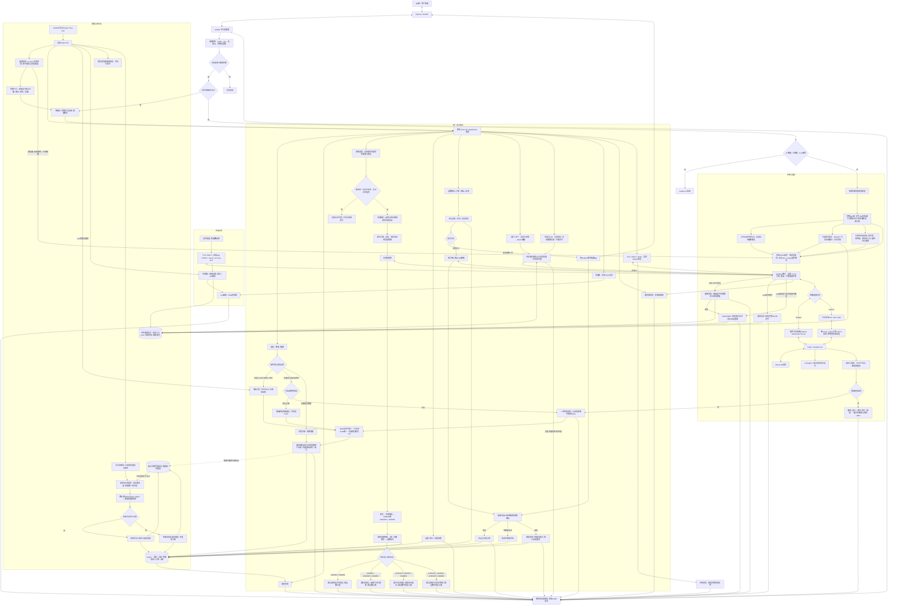

# 完整流程拓扑

本文对应 1.4.0 版本。运行主体是一个 AstrBot 插件。QQ 消息由现有 NapCat/OneBot 接入，游戏侧使用 Paper 和官方 QueQiao；插件独立管理身份、点数、交付和配置。隔离测试范围与结果见 [验证记录](VALIDATION.md)，真实 QQ/Paper 服务尚未联调。

[打开 1.2 静态 SVG 拓扑，可独立查看和放大](architecture.svg)。该 SVG 保留此前的生成与验证结果；下方 Mermaid 源图已补充当前签到策略流程，最新管理路径另见正文。



## 关键顺序

1. 消息身份和 UMO 在入口固定。显式指令处理后停止继续流转；只有未被指令、AI 或其他处理器接管的普通群消息进入最后的转发处理器。
2. 每个新签到请求先检查路由当地的每日允许时段；时段外不发送游戏命令。允许时校验绑定、选择日期活动、保存抽样和最终奖励，再执行游戏签到，最后检查本群签到日期。活动只取最高优先级一项，倍率按十进制计算并向下取整，或替换奖励范围。重复同一消息使用原操作，已确认游戏结果的恢复只结算本地。回复分别呈现 `group_status` 与 `game_status` 的四种成功/重复组合，只有群本次成功会入账。
3. RCON 完整回包先经过共用清洗器。签到与自定义模板动作再用对应规则生成状态和字段、渲染回复；实时查询和管理员 `cmd` 返回完整清洗文本。收到文本不等于已确认游戏内副作用成功，未知状态不会被当成成功。
4. 订单先冻结可用点数和库存，再交付。外部交付无法与 SQLite 原子提交，因此明确保存 sending/unknown 并要求核对，不承诺网络级“恰好一次”。
5. 插件重载先拒收并处理在途操作，保存未知结果，最后关闭后台任务和数据库；启动仅恢复可确定的本地事务，不自动重放外部命令。
6. 普通成员的绑定与换绑按 `binding_verification_enabled` 选择验证模式，默认 `false` 直接按玩家名办理；普通解绑检查冷却。管理员为他人或自己绑定、换绑、解绑均直接办理，免本次 CD 且无需验证码，GUI 管理员解绑使用同一路径。唯一约束继续生效，成功后作废旧验证码，保留历史、版本及后续普通用户操作的冷却；未验证记录不伪造 UUID。
7. 正向由插件发起连接；反向由 QueQiao 发起，多服可以共用监听端口和路径，按 `server_name` 分流且必须使用 token。两种方向共用请求关联、事件分发与不确定结果策略。
8. `服务器状态` 读取连接状态，仅回复在线/离线；`tps`、`mspt`、`ping` 默认调用同名 RCON 命令并清洗后回复原文；`性能图` 单独返回历史 PNG，后台自动采样与 GUI 曲线继续保留。普通 `ping` 没有可解析毫秒数时保留缺失点，不伪造数值，QQ 仍能看到实际回包。
9. QQ 原公开附件地址直接转为点击链接；媒体缓存是可选项。前缀 `{reply}` 在指定位置插入带 hover 的引用组件，正文不再重复；旧模板无槽位时保留原消息段位置。9 类语义标签通过 `message_colors` 独立配色。引用先验证同会话归属，悬浮按原作者、原消息内容、`Date: 原消息时间` 三行展示，保留消息颜色与附件摘要；时间来自原消息时间戳并按路由时区显示，缺失时为“未知”。原版客户端使用链接访问图片/语音/视频，不生成 ChatImage CICode。
10. 管理员 `cmd cmi ping rincho` 将字面命令发往当前群路由服务器，无需绑定；JSON 中的花括号不做模板插值。它与自定义命令共用持久操作记录，同一 UMO/消息 ID/action 不重复发送，UNKNOWN 不自动重放。`cmd` 是手工控制台操作，不创建商店订单或冻结点数，回复回到原 UMO。
11. 旧数据迁移先只读预览，再选择绑定和目标服务器、处理唯一性冲突，确认源 `digest` 与迁移 `plan_digest` 后原子导入。账本已迁移时仅补导选定绑定，不再次写入余额。迁移完成标记独立于当前绑定保存，解绑不会删除标记或导致下次导入自动恢复旧绑定；数据或计划变化须重新预览确认。

## 代码布局

1.3 增加的管理路径：帮助从框架生效命令生成完整编辑表，叠加稳定动作 ID 的说明、显隐与排序后，按当前用户权限构建同一份文字/图片文档。数据列表经过鉴权 API 进入白名单分页查询，返回当前页和总数。服务器 ID 修改则先取得配置锁、暂停新业务并排空在途动作，写入恢复日志后更新各库和配置，恢复连接；失败期间保持维护态并在重载时恢复。具体请求与恢复约定见 [接口契约](IMPLEMENTATION_CONTRACT.md) 和 [1.3 更新说明](UPGRADE_1_3.md)。

1.4.0 的帮助图片路径严格使用全局帮助顺序，逐列从上到下、从左到右排布，每列最多 15 条命令，标题不计数。列数为可见命令数除以 15 向上取整，最少一列；连续的同类内容使用矩形，跨列或被其他分类打断后标“续”。全局编号与实际绘制顺序一致，帮助命令默认第一，用户显式排序覆盖优先。计算单图尺寸后响应原 UMO，不进行图片分页；超过渲染尺寸上限、缺少中文字体或渲染失败时发送同份完整文字。现有图片开关、隐藏与权限过滤继续生效；布局示例见[单图样张](screenshots/help-example.png)。

签到策略由 `core.signin_policy` 纯函数计算，和 RCON、随机抽样、账本持久化分开。GUI 的 `preview_signin_policy` 只读取已保存路由并计算候选结果；运行时在通过时段检查后抽样一次，将规则和奖励保存到签到操作。同点数作用域的路由校验相同策略；GUI 保存时段或活动时同步该作用域内的路由。

```text
main.py                       AstrBot 生命周期、消息和鉴权 API
adapters/astrbot_commands.py   4.29 指令注册兼容层
core/config.py                配置模型和原子持久化
core/text.py                  清洗、解析和模板
core/signin_policy.py         每日时段、日期活动与纯奖励预览
core/store.py                 事务账本、身份、订单和迁移
services/application.py       组合入口、自定义动作和管理员cmd
services/dashboard.py         账户与诊断的受限分页查询
services/help_renderer.py     帮助元数据、文字与单张多栏图片
services/domain.py            绑定、签到和商店
services/gateway.py           QueQiao V2
services/media.py             只读限时媒体服务
services/relay.py             富消息双向转发
services/monitor.py           周期采样和图片
views/dashboard/              内嵌 GUI
tests/                        核心、真实框架与浏览器验收
docs/                         设计、迁移、部署及验证记录
```

QQ 与玩家名全局唯一，取得真实 UUID 的已验证绑定还具有 UUID 唯一约束；点数按 `scope + QQ` 隔离；消息按原始 UMO 路由；外部请求按服务器和 echo 关联。`server.name` 继续用于握手身份，`server.display_name` 和 `route.display_name` 只改变展示。将这些标识分开，可避免改指令名、迁移群会话或多服回包串线破坏业务身份。

协议依据与部署细节见 [传输说明](TRANSPORT.md)，包含 [QueQiao 正反向配置](https://queqiao-docs.pages.dev/config/)、[官方 V2 协议](https://queqiao-docs.pages.dev/api/v2/)、[用户指定参考项目的富消息解析](https://github.com/17TheWord/nonebot-plugin-mcqq/blob/main/nonebot_plugin_mcqq/utils/parse_qq_msg.py) 和 [Minecraft 组件格式变更](https://www.minecraft.net/en-us/article/minecraft-java-edition-1-21-5)。SVG 可独立查看；离线渲染、协议模拟和框架测试不代表已经完成真实群服联调。
