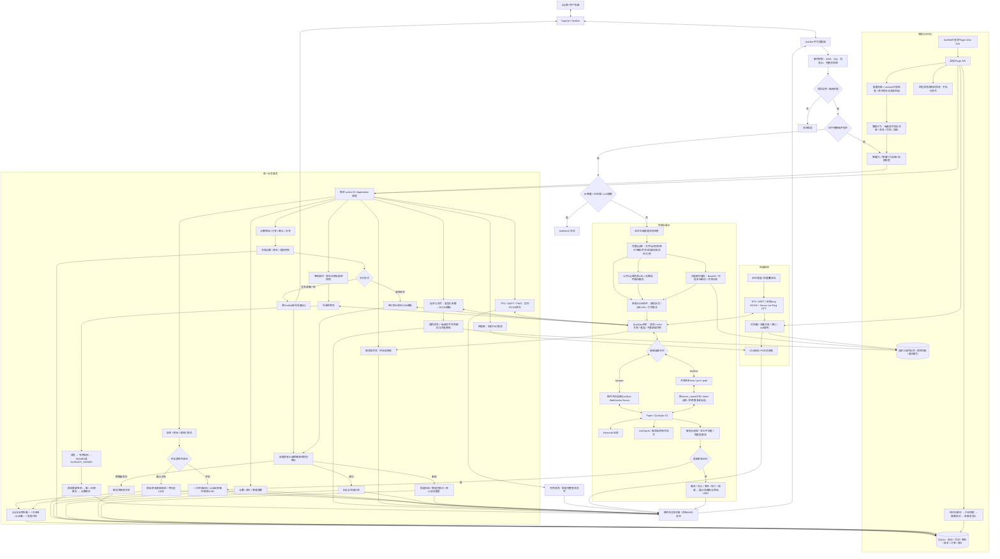

# 完整流程拓扑

本文对应 1.1 版本。运行主体是一个 AstrBot 插件。QQ 消息由现有 NapCat/OneBot 接入，游戏侧使用 Paper 和官方 QueQiao；插件独立管理身份、点数、交付和配置。以下流程已通过离线协议和框架测试，真实 QQ/Paper 服务尚未联调。

[打开完整 SVG 拓扑，可独立查看和放大](architecture.svg)。下方 Mermaid 是可编辑源图；SVG 使用 Mermaid 11.12.0 生成，并通过浏览器验证。



## 关键顺序

1. 消息身份和 UMO 在入口固定。显式指令处理后停止继续流转；只有未被指令、AI 或其他处理器接管的普通群消息进入最后的转发处理器。
2. 游戏签到是每个新签到请求的第一项外部动作。重复的同一消息投递由操作 ID 去重；新的消息仍先询问游戏，再检查本群签到日期。
3. RCON 完整回包先经过共用清洗器，再由对应动作规则生成状态和字段，最后由该动作回复模板渲染。未知状态不会被当成成功。
4. 订单先冻结可用点数和库存，再交付。外部交付无法与 SQLite 原子提交，因此明确保存 sending/unknown 并要求核对，不承诺网络级“恰好一次”。
5. 插件重载先拒收并处理在途操作，保存未知结果，最后关闭后台任务和数据库；启动仅恢复可确定的本地事务，不自动重放外部命令。
6. `binding_verification_enabled` 默认 `false`，用户提交玩家名即直接绑定；开启后才走游戏内验证码。两种模式使用同一套唯一约束、历史、版本和冷却。未验证记录不伪造 UUID。
7. 正向由插件发起连接；反向由 QueQiao 发起，多服可以共用监听端口和路径，按 `server_name` 分流且必须使用 token。两种方向共用请求关联、事件分发与不确定结果策略。
8. `状态` 读取连接状态，仅回复在线/离线；`tps`、`mspt`、`ping` 清洗后回复 RCON 原文；`性能图` 单独返回历史 PNG，后台自动采样与 GUI 曲线继续保留。
9. QQ 原公开附件地址直接转为点击链接；媒体缓存是可选项。引用从当前会话取得完整链并验证归属，支持颜色悬浮。原版客户端使用链接访问图片/语音/视频，不生成 ChatImage CICode。

## 代码布局

```text
main.py                       AstrBot 生命周期、消息和鉴权 API
adapters/astrbot_commands.py   4.29 指令注册兼容层
core/config.py                配置模型和原子持久化
core/text.py                  清洗、解析和模板
core/store.py                 事务账本、身份、订单和迁移
services/application.py       组合入口和自定义动作
services/domain.py            绑定、签到和商店
services/gateway.py           QueQiao V2
services/media.py             只读限时媒体服务
services/relay.py             富消息双向转发
services/monitor.py           周期采样和图片
views/dashboard/              内嵌 GUI
tests/                        核心、真实框架与浏览器验收
docs/                         设计、迁移、部署及验证记录
```

QQ 与玩家名全局唯一，取得真实 UUID 的已验证绑定还具有 UUID 唯一约束；点数按 `scope + QQ` 隔离；消息按原始 UMO 路由；外部请求按服务器和 echo 关联。`server.name` 继续用于握手身份，`server.display_name` 和 `route.display_name` 只改变展示。将这些标识分开，可避免改指令名、迁移群会话或多服回包串线破坏业务身份。

协议依据与部署细节见 [传输说明](TRANSPORT.md)，包含 [QueQiao 正反向配置](https://queqiao-docs.pages.dev/config/)、[官方 V2 协议](https://queqiao-docs.pages.dev/api/v2/)、[用户指定参考项目的富消息解析](https://github.com/17TheWord/nonebot-plugin-mcqq/blob/main/nonebot_plugin_mcqq/utils/parse_qq_msg.py) 和 [Minecraft 组件格式变更](https://www.minecraft.net/en-us/article/minecraft-java-edition-1-21-5)。SVG 可独立查看；离线渲染、协议模拟和框架测试不代表已经完成真实群服联调。
