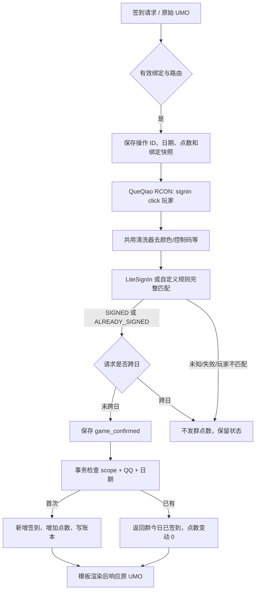
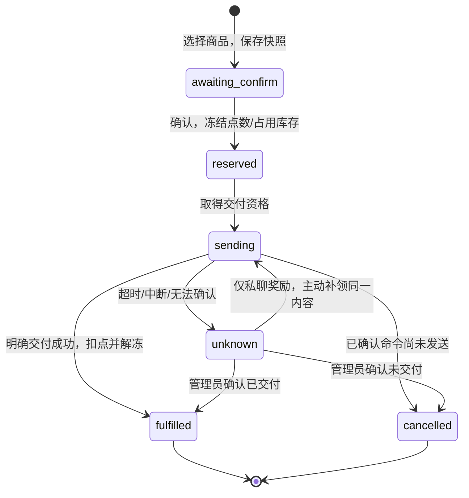

# 绑定、签到和点数商店

业务服务位于 `services/domain.py`，事务存储位于 `core/store.py`。消息适配、GUI 和命令管理调用同一套服务。数据库事务只包含本地读写，网络请求在事务外执行；外部结果不确定时保留待核对状态。

## 身份与作用域

默认关闭 `binding_verification_enabled`，QQ 用户提交玩家名即可绑定，不需要进入游戏输入验证码。QQ ID 与玩家名在整个插件中双向唯一，玩家名忽略大小写比较。直接绑定记录为 `identity=name:小写玩家名`、`verified=false`、`mc_uuid=null`；它表示声明使用该玩家名，不表示已经验证实际游戏账号控制权，也不会伪造 Minecraft UUID。

开启验证码验证后，QQ 端提交玩家名会生成有效期 5 分钟、只能使用一次的验证码；指定玩家必须在指定服务器发 `bind 验证码`。插件从经认证的 QueQiao 玩家事件取得真实 UUID，匹配玩家名及服务器后原子完成绑定，记录为 `identity=uuid:真实UUID`、`verified=true`。玩家名和 UUID 都不能被另一个 QQ 占用。验证码只保存摘要，不作为聊天内容转发到群。开启或关闭开关不会自动更改已有绑定，已有真实 UUID 也不会因直接绑定同一玩家名而降级。

修改绑定遵守当前验证模式，成功前保留原绑定。绑定变更同时记录 QQ、原玩家名、新玩家名及已知 MC UUID 的冷却期限；解绑不会清除冷却或历史，也不会清除余额和签到。解绑后把相同账号重新绑定仍获得新的绑定版本，旧订单不能把它误认成原来的绑定。管理员解绑默认也遵守冷却；后台显式 `force` 可执行管理解除并继续保留冷却。

同一 QQ 在同一服务器为现有未验证玩家名补充验证码证明属于身份升级，不算换绑：无需等待该 QQ/玩家名原有冷却，保留原剩余期限且增加绑定版本，但仍检查目标 UUID 自身的冷却与唯一归属。旧版本本插件中的真实 UUID 绑定会事务升级，保留真实 UUID、绑定历史和冷却；遇到历史同名冲突会拒绝升级并保留原数据，不静默覆盖身份。

业务点数由 `scope + QQ ID` 标识。每个 UMO 可以配置独立作用域，也可显式共享作用域。绑定不分群；当前实现同时记录目标服务器，游戏签到和游戏商品要求当前路由服务器与绑定服务器一致。游戏请求校验绑定 `identity + version`，未验证绑定也不能因 UUID 均为空而被误认为同一账号。

## 两阶段签到



每次新的签到请求都先执行游戏签到，得到“本次签到成功”或“游戏今天已经签到”后，才判断群签到。相同消息 ID 的重复投递使用已有操作结果，不再次调用游戏命令。MC 返回的玩家必须符合期望玩家；空回复、未知回复和超时不会被当成签到成功。

业务日期使用路由时区，默认 `Asia/Shanghai`。点数在请求创建时确定并持久化；范围下限等于上限即为固定奖励。每个 QQ 的游戏签到请求串行处理，数据库唯一约束最终保证同一作用域、QQ、日期只入账一次。新的插件不执行旧插件的倍率、时间窗或补签重置流程。

群签到首次成功默认回复：

```text
签到成功✅️
本次获得 {points_delta}{points_name}，当前{points_name}：{balance}
{rcon}
```

群内当日已经签到则默认回复 `签到失败❌️ 今日已签到，请不要重复签到。`，仍会先执行此次游戏签到。游戏返回已签到、群尚未签到时仍是首次群签到成功；未知、失败或超时不会冒充“群今日已签到”。

成功模板为 `route.templates.signin`，重复群签到模板为 `route.templates.signin_already`。可用字段包括 `player`、`player_name`、`game_status`、`group_status`、`game_status_text`、`group_status_text`、`points_delta`、`points_name`、`balance`、`day`、`game_continuous_days`、`rcon`。游戏重复签到回包没有连续天数时，该字段为空。`rcon` 使用通用清洗器去除颜色和控制代码，保留 `[手记人偶]` 等完整插件前缀；解析器另行移除已配置前缀，不影响展示。`rcon` 与货币名称随游戏确认结果持久化，重复消息和恢复结算使用原回包与名称。

进程中断时，已确认游戏结果的 `game_confirmed` 操作会在启动恢复中完成本地入账。已发送但尚未确认的操作转为 `unknown`，不会自动重放游戏指令；管理员可检查原始处理状态，再让用户发起新的签到请求。此前未发送的旧日请求不能在次日代替新请求执行。

## 点数与订单

点数就是群积分，没有另外一种游戏点数货币或双向兑换。全局 `points_name` 默认“点数”，可改为自定义货币名称，应用于签到、余额、排行榜、商店、订单和管理员调整回复；改名只改变显示，不转换或重置已有余额。商店购买先生成 3 分钟有效的待确认订单，不立即扣点。确认时在一个事务中验证商品版本、限购、库存和可用点数，冻结订单金额并分配一次奖励。

`可用点数 = 总点数 - 冻结点数`。并发购买和管理员调整都不能使用其他订单已经冻结的点数。管理员修改有独立操作 ID，重复同一请求只执行一次；管理员、变更方式、金额、原因写入审计。

群管理员命令支持 `添加点数 QQ号 数量 [原因]`、`扣除点数 QQ号 数量 [原因]`、`设置点数 QQ号 数量 [原因]`；QQ 号可替换为能唯一定位的绑定玩家名。只填写一个数量时调整管理员自己的账户。原因可以包含空格，省略时审计记录为“群管理员调整”。实际触发名称以 AstrBot 命令管理配置为准。



| 商品类型 | 成功依据 | 未确认时的处理 |
| --- | --- | --- |
| `text` 私聊内容 | OneBot 返回消息 ID | 保留同一内容和冻结点数，允许用户主动补领 |
| `code` 唯一码 | OneBot 返回消息 ID | 保留已分配的同一码，补领不换码；已分配的码不重新入库 |
| `rcon` 游戏命令 | 规则完整匹配配置的成功状态 | 保留冻结点数，不自动重发；管理员核实游戏结果后结算 |

已完成私聊订单也可以补领同一份奖励，不再次扣点。游戏商品不能自动补领；自定义命令返回一段“失败”文字也不必然证明没有副作用，因此只有连接层明确确认尚未发送时才直接取消并释放点数。其他情况由管理员填写核对依据，确认已交付或确认未交付。

商品修改后，尚未确认的旧版本订单不能继续购买；已占用的订单保留当时商品快照，不随商品内容变化。游戏商品在发送前核对绑定版本，包括进程恢复后的已预留订单。用户应先处理未完成订单，再新建其他订单。

启动恢复只整理本地状态，不主动执行外部交付：`sending` 转为 `unknown`，`reserved` 等待用户确认或管理员处理。旧插件迁入的已付款订单使用单独的 `paid_pending` 状态，不会再次扣点，详见 [迁移说明](MIGRATION.md)。

## 管理与数据边界

群命令受当前 UMO 路由和管理员权限约束。后台管理由 AstrBot 已认证的插件 API 调用，`Domain.admin` 本身不接收匿名请求。普通状态快照、排行榜和订单列表不含私聊奖励、兑换码池或游戏商品命令；管理员可以单独读取商品详情进行编辑。

SQLite 保存绑定历史、冷却、签到操作、账本、订单快照及审计。会话路由使用真实 UMO，主动绑定成功通知回到发起验证的 UMO，私聊奖励通过当前 OneBot 账号显式发送给下单 QQ，不拼接假私聊 UMO。所有未知交付都需要通过业务状态核对，不能仅靠日志里出现错误就重复发送。
